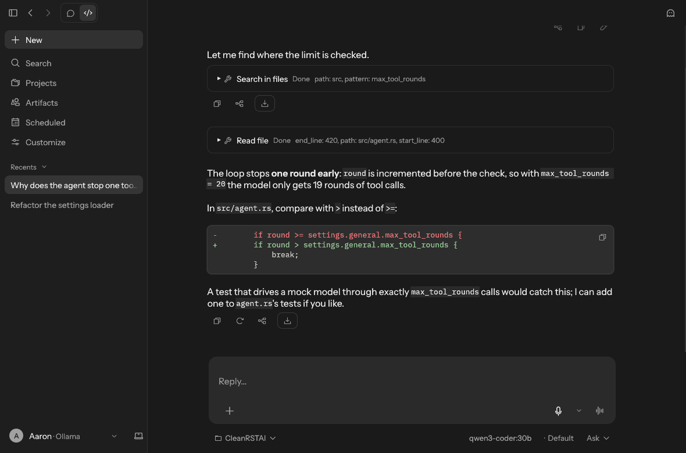
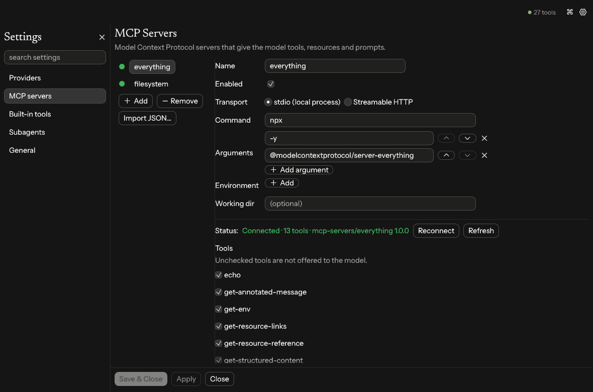

# CleanRSTAI

A fast, native desktop AI chat client written in Rust. It talks to any **OpenAI-compatible**
endpoint and gives the model tools through **MCP servers** (stdio and Streamable HTTP).

macOS is the primary platform; Linux and Windows are fully supported.



## Features

- **Any OpenAI-compatible API**: OpenAI, OpenRouter, Groq, Mistral, DeepSeek, Together, Gemini,
  or local servers such as Ollama, LM Studio, llama.cpp and vLLM. You can configure several
  provider profiles and switch between them from the toolbar.
- **Model discovery**: *Fetch models* calls `GET /models` and fills the model picker.
- **Streaming** responses (SSE), with a non-streaming fallback for servers that don't support it.
- **Reasoning display**: `reasoning_content` / `reasoning` output appears in a collapsible
  *Thinking* section.
- **MCP client**:
  - **stdio** servers (`npx`, `uvx`, `docker`, any binary) with arguments, environment
    variables and a working directory.
  - **Streamable HTTP** servers with custom headers (e.g. `Authorization`), session handling,
    and both JSON and SSE responses.
  - Live connection status, tool list, per-tool enable/disable, server stderr log, reconnect.
  - Import the standard `{"mcpServers": {...}}` JSON used by Claude Desktop, Cursor and others.
- **Tool calling loop**: the model can call tools across multiple rounds. Each call shows its
  arguments and result, and asks for your approval unless you turn on auto-approve.
- **Conversations** are saved automatically and can be searched, renamed and deleted. You can
  edit and resend a message, regenerate a reply, or stop a generation.
- **Markdown rendering** with syntax-highlighted code blocks and tables.
- **Everything is configurable in the UI**: providers, MCP servers, system prompt, theme
  (system/light/dark), UI scale, send key, tool approval, round limit and timeouts.



## Build & run

Requires Rust 1.95 or newer (`rustup update`).

```sh
cargo run --release
```

### macOS app bundle

```sh
cargo install cargo-bundle
cargo bundle --release
open target/release/bundle/osx/CleanRSTAI.app
```

## Releases

Pushing a version tag runs `.github/workflows/release.yml`:

```sh
# bump `version` in Cargo.toml first; the tag must match it
git tag v0.1.0 && git push origin v0.1.0
```

It builds:

| File | Platform |
|---|---|
| `CleanRSTAI-macos-universal.zip` | macOS `.app`, Apple Silicon + Intel (ad-hoc signed) |
| `CleanRSTAI-linux-x86_64.tar.gz` | Linux x86_64 |
| `CleanRSTAI-linux-aarch64.tar.gz` | Linux ARM64 |
| `CleanRSTAI-windows-x86_64.zip` | Windows x86_64 |

plus `SHA256SUMS.txt`, and publishes them in two places:

- **GitHub Releases**: a release for the tag with the files attached (tags containing `-`, such
  as `v0.2.0-beta.1`, are marked as pre-releases).
- **GitHub Packages**: an OCI artifact at `ghcr.io/<owner>/cleanrstai:<tag>`. Stable versions
  are also tagged `latest`. Download with [ORAS](https://oras.land):
  ```sh
  oras pull ghcr.io/aaronbolton/cleanrstai:v0.1.0
  ```

You can also release without pushing a tag: *Actions → Release → Run workflow* with a
`version` such as `v0.1.0` creates the tag on the selected branch and publishes. Leaving
`version` empty only builds; the files are kept as workflow artifacts.

> The macOS app is ad-hoc signed only, so on first launch macOS will block it. Right-click the
> app and choose **Open**, or run `xattr -dr com.apple.quarantine CleanRSTAI.app`.

### Linux

Building needs no extra packages beyond a C compiler. At runtime you need a desktop with X11 or
Wayland (`libxkbcommon-x11` and a GL/Vulkan driver, which standard desktops already have).

### Windows

`cargo build --release` produces `target/release/cleanrstai.exe`. Release builds don't open a
console window.

## Configuration

Open **⚙ Settings** (or press ⌘/Ctrl + ,).

| Tab | What you can set |
|---|---|
| Providers | Name, base URL (with presets), API key, model, temperature, max tokens, streaming, timeout, extra headers |
| MCP Servers | Add, import, enable or disable servers; stdio command/args/env/cwd or HTTP URL/headers; per-tool toggles |
| General | System prompt, theme, UI scale, send key, auto-approve tools, max tool rounds, tool timeout, export |

Changes take effect when you click **Apply** or **Save & Close**. Only MCP servers whose
connection settings changed are reconnected.

Files are stored at:

| | Settings | Conversations |
|---|---|---|
| macOS | `~/Library/Application Support/net.bukn.CleanRSTAI/settings.json` | `~/Library/Application Support/net.bukn.CleanRSTAI/conversations/` |
| Linux | `~/.config/cleanrstai/settings.json` | `~/.local/share/cleanrstai/conversations/` |
| Windows | `%APPDATA%\bukn\CleanRSTAI\config\settings.json` | `%APPDATA%\bukn\CleanRSTAI\data\conversations\` |

### Export and import

**Settings → General → Export & import** saves a JSON file through the system save dialog:

- **Export settings…** writes providers, MCP servers and preferences as last saved. By default,
  API keys, HTTP header values and MCP environment variable values are left blank, while
  their names are kept. Tick *Include API keys and secrets* for a complete backup.
- **Export conversations…** writes every chat, including tool calls and their results, to a
  single file.

**Import settings…** loads a settings export into the Settings window for review:

- **Merge** adds the imported providers and MCP servers, updating ones that already exist, and
  keeps your other preferences.
- **Replace** uses the imported settings as they are.

Secrets left blank in the export are filled from matching entries you already have, and
anything still blank is listed so you can fill it in before applying. **Import
conversations…** adds chats from a conversations export and skips any that already exist.

Both files record the app version and export time. They are created readable only by you on
macOS and Linux. On Linux the save dialog uses the desktop portal (`xdg-desktop-portal`),
which standard desktops already provide.

### Secrets

API keys, HTTP header values and MCP environment variable values are stored in the system
keychain: the macOS Keychain, Windows Credential Manager, or the Secret Service
(GNOME Keyring, KWallet) on Linux. `settings.json` keeps only blank placeholders, and keys
saved in plain text by earlier versions move to the keychain on first launch.

If no keychain is available, secrets stay in `settings.json` and the app says so. You can
also turn this off in **Settings → General → Secrets**. On macOS and Linux the file is
readable only by you.

### MCP examples

Paste either of these into **MCP Servers → Import JSON…**:

```json
{
  "mcpServers": {
    "filesystem": {
      "command": "npx",
      "args": ["-y", "@modelcontextprotocol/server-filesystem", "/Users/me/Documents"]
    },
    "fetch": { "command": "uvx", "args": ["mcp-server-fetch"] },
    "remote": {
      "url": "https://example.com/mcp",
      "headers": { "Authorization": "Bearer <token>" }
    }
  }
}
```

GUI apps on macOS start with a minimal `PATH`. CleanRSTAI imports the `PATH` from your login
shell at startup, so `npx`, `uvx`, `docker` and Homebrew tools are found the same way your
terminal finds them. On Windows, `npx` resolves to `npx.cmd` automatically.

Tools are shown to the model as `<server>__<tool>`, so give servers short, descriptive names.

## Keyboard shortcuts

| Shortcut | Action |
|---|---|
| Enter / Shift+Enter | Send / newline (can be swapped in General settings) |
| ⌘/Ctrl + Enter | Send |
| ⌘/Ctrl + N | New chat |
| ⌘/Ctrl + , | Settings |

## Development

```sh
cargo test                  # unit tests
cargo test -- --ignored     # end-to-end tests: mock LLM + the reference MCP "everything"
                            # server over stdio and Streamable HTTP (needs Node/npx)
cargo clippy --all-targets
```

Source layout:

```
src/
  main.rs         startup: PATH fix, tokio runtime, eframe window
  app.rs          main UI: sidebar, chat view, input, event handling
  ui/settings.rs  settings window (providers, MCP servers, general)
  ui/widgets.rs   key/value and list editors
  agent.rs        generation loop: stream, run tool calls, repeat
  llm.rs          OpenAI-compatible /chat/completions and /models client
  sse.rs          incremental Server-Sent Events parser
  mcp/            MCP client: stdio and Streamable HTTP transports, connection manager
  config.rs       settings model, persistence, mcpServers JSON import
  export.rs       settings / conversations export with secret redaction
  types.rs        messages and conversation storage
  env_path.rs     login-shell PATH import for GUI launches
```

The UI is built with [egui](https://github.com/emilk/egui) and runs on the main thread. Network
and MCP I/O run on a tokio runtime and send events back over a channel.
