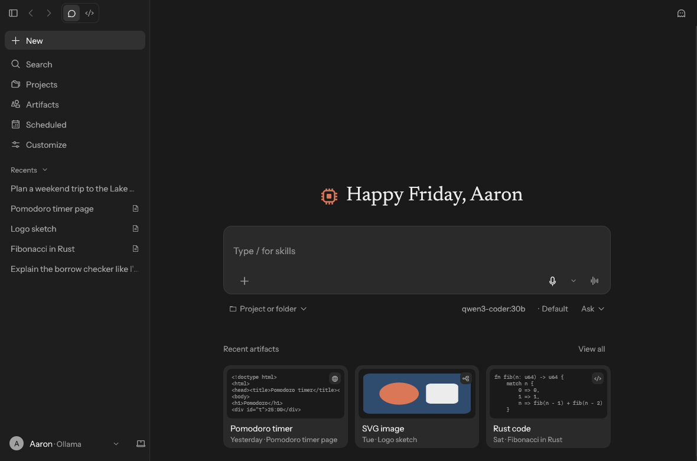
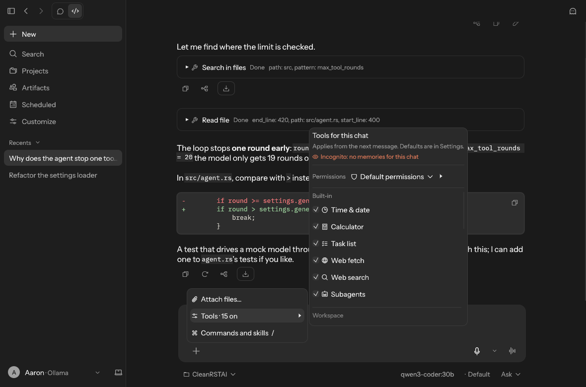
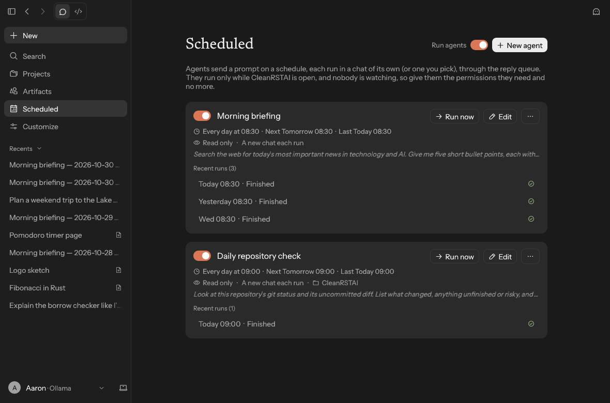

<p align="center">
  <picture>
    <source media="(prefers-color-scheme: dark)" srcset="assets/icon/window-dark.png">
    
  </picture>
</p>

<h1 align="center">CleanRSTAI</h1>

<p align="center">
  <a href="https://d3v0ps-cloud.github.io/CleanRSTAI/"><b>Documentation</b></a> ·
  <a href="https://d3v0ps-cloud.github.io/CleanRSTAI/getting-started/installation.html">Installation</a> ·
  <a href="https://d3v0ps-cloud.github.io/CleanRSTAI/getting-started/first-chat.html">Your first chat</a> ·
  <a href="https://d3v0ps-cloud.github.io/CleanRSTAI/settings/">Settings</a> ·
  <a href="https://github.com/d3v0ps-cloud/CleanRSTAI/releases/latest">Latest release</a>
</p>

A fast, native desktop AI chat client written in Rust. It talks to any **OpenAI-compatible**
endpoint and gives the model tools through **MCP servers** (stdio and Streamable HTTP).

macOS is the primary platform and Linux is fully supported. Windows builds are released
too, as an installer and a portable `.exe`.


## Features

- **Any OpenAI-compatible API**: OpenAI, OpenRouter, Groq, Mistral, DeepSeek, Together, Gemini,
  or local servers such as Ollama, LM Studio, llama.cpp and vLLM. You can configure several
  provider profiles and switch provider and model from the picker under the message box (or
  with ⌘K).
- **Native APIs** beside Chat Completions, chosen per provider: OpenAI's **Responses** API
  (reasoning summaries, reasoning kept between tool calls) and Anthropic's **Messages** API
  (extended thinking, prompt caching).
- **Reasoning effort and sampling**: reasoning effort, thinking budget, temperature, top-p,
  max tokens and stop sequences per provider, per model and per chat (from the effort label
  under the message box), each left to the server until you set it.
- **Model discovery**: *Fetch models* calls `GET /models` and fills the model picker.
- **Streaming** responses (SSE), with a non-streaming fallback for servers that don't support it.
- **Speed and token stats**: under every reply, prefill and decode speed, prompt time and
  tokens in and out, plus a running total for the chat. llama.cpp's own `timings` are used
  when the server reports them, and the cost when OpenRouter or a LiteLLM proxy reports it
  (for LiteLLM's streamed replies, estimated from its listed prices), and with LiteLLM the
  deployment that served each reply, retries and fallbacks, key spend and rate limits left;
  otherwise speeds are measured from the stream. With llama.cpp the stats also show how full
  the context is, turning to a warning colour from 80%, and a progress bar while the server
  reads a long prompt; an info icon beside the model picker shows the model file, size,
  parameters, trained context and whether the server is loading it or asleep. With a
  llama.cpp router (several models on one server), the model picker shows which models are
  loaded and loads or unloads them. Ollama, LM Studio, vLLM and OpenRouter have their own
  types too: context use against the size the model runs with, and an info icon with what the
  server reports (load state, GPU memory, quantization, queue and KV cache, prices, credit
  left). Set **Server type** on a provider (or click **Detect**) to get these extras.
- **Reasoning display**: `reasoning_content` / `reasoning` output appears in a *Thought
  process* section, collapsed by default. **Settings → Appearance → Reasoning** can keep it expanded, or
  expanded only while the model is thinking.
- **Built-in tools** that work without any MCP server:
  - **Time & date**: the current date, time, weekday and time zone, and the time at other UTC
    offsets.
  - **Calculator**: exact arithmetic and functions (powers, roots, logarithms, trigonometry,
    rounding, min/max/avg) instead of the model's mental maths.
  - **Task list**: for multi-step requests the model breaks the work into actionable tasks,
    shows them as a checklist in the chat and ticks them off as it goes.
  - **Web fetch**: reads an http(s) URL. Web pages come back as readable text with their
    links listed, plain text and JSON as they are, and images as images; long pages are read
    in parts. Downloads stop at 5 MB. It only reaches public internet addresses (not
    localhost, private networks or cloud metadata endpoints, also after a redirect) unless
    *Let web fetch reach this computer and private networks* is on.
  - **Web search**: searches the web and lists the results (title, address, snippet) for the
    model to read with web fetch. DuckDuckGo works without an account; a SearXNG instance
    (your own, even on localhost), the Brave Search API, Tavily or the Kagi Search API can be
    chosen instead, with the result count, safe search and whether to ask before each search.
    Anthropic, OpenAI (Responses API) and OpenRouter can search with their own search instead,
    and the reply lists the pages it cites.

  Time, calculator and task list run locally without asking. Web fetch and web search reach the
  internet, so they ask for approval like MCP tools do ("Always allow this tool" skips that for
  the rest of the chat). Switch each one in **Settings → Built-in Tools**.
- **Workspace**: give a chat a local working folder with **Project or folder** under the
  message box (or switch the title row to **Code**), and the model gets tools to work in it: `read_file`, `file_glob_search`,
  `grep_search`, `get_info`, `git_status` and `git_diff` run freely; `write_file`, `edit_file` and
  `exec_shell_command` ask for approval first. Every path is kept inside the folder (no `..`,
  outside absolute paths or symlinks out), searches skip files ignored by `.gitignore`, and
  commands run in the folder with `sh` (`cmd` on Windows). Switch the tools off in
  **Settings → Built-in Tools** or per chat.
  - **Commits**: with **Commit (git_commit)** on (off by default), the model can commit the
    folder's changes, or chosen files, to its git repository locally. Every commit asks for
    approval, nothing is pushed, and a **Commit…** dialog does the same by hand.
  - **Project instructions**: an `AGENTS.md` or `CLAUDE.md` in the folder (names, order,
    parent folders and size limit are configurable) goes into the system prompt.
  - **Diffs and undo**: `write_file` and `edit_file` show their change as a diff on the
    approval prompt and in the tool card, and keep a checkpoint, so **Undo file edits** puts
    back the files a turn changed (files changed again since are left alone). **Changed files**
    lists every file a chat changed, with its diffs.
- **Slash commands**: saved prompts typed as `/name` in the message box, with `{{args}}`
  filled in, kept in Settings or as `.cleanrstai/commands/*.md` files in the chat's folder.
- **Skills**: folders of instructions (a `SKILL.md` file, optionally with a name and a
  description in front matter) from your skills folder or the chat's `.cleanrstai/skills`
  folder. The model sees their names and descriptions and loads one with `load_skill` when a
  task matches; other files in a skill's folder can be read the same way. Each skill can be
  switched off, and **Settings → Skills & hooks** has the size limit and an **Open skills
  folder** button.
- **Hooks**: commands from Settings that run before a tool call (a non-zero exit blocks the
  call), after one (the output is added to the result), or when a reply is done (the output is
  a notice), with a tool-name filter, a timeout and a per-chat switch. They run in the chat's
  folder, or in its Docker sandbox when that is on.
- **Projects**: group chats, listed as cards on the **Projects** page. A project's instructions and reference files go to
  every chat in it, and its folder, provider, model, tool switches and permission mode are what
  a new chat starts with. Export a project with its chats to one file, and import it again.
- **Memory** (off by default): the model can save facts about you (with your approval, if you
  like) and delete them, and the saved facts go into the system prompt of new replies. Global or
  per project, with a size limit, and an incognito chat with no memory at all.
- **Context compaction**: when a chat nears the model's context size, the older messages are
  summarised (by the chat's model or one you choose) and only the summary and the latest
  messages are sent; a marker in the chat shows where. **Compact now** does it by hand, and
  older tool results can be shortened instead. Threshold, kept messages, context size and the
  summary instructions are in **Settings → Context & files**; every one of these features can
  be switched per chat under **Chat features** in the tools menu.
- **Code review**: **Review changes** sends the working folder's git diff (uncommitted changes,
  or a branch against its base) to a model with a review prompt, as a normal chat reply. The
  review model, prompt and size limit are in **Settings → Context & files**.
- **Docker sandbox** (off by default): run the workspace shell commands in a Docker container
  with only the chat's folder mounted, no network by default (or only the hosts, ports and
  protocols you allow), and CPU, memory and process limits. Use a published image or a custom
  Dockerfile (a small and a full example, with Python, Node.js, build tools and network tools,
  are built in); the full image is also published as
  `ghcr.io/d3v0ps-cloud/cleanrstai-sandbox:full`. See the
  [Docker sandbox settings](https://d3v0ps-cloud.github.io/CleanRSTAI/settings/docker.html).
- **Subagents**: a `delegate` tool lets the model hand independent tasks to subagents that work
  in parallel and report back. Each subagent's progress, tools and result show in the chat, and
  their token usage counts towards the chat's totals. **Settings → Subagents** sets their
  provider and model (or lets the model pick a provider profile per task, e.g. a fast local
  model for simple tasks), system prompt, tool access, how many run at once, round limit and
  time limit. With the Docker sandbox on, subagents can also use the workspace, each running
  commands in a container of its own on the chat's network.
- **Voice**: dictate into the message box with the microphone (⌘/Ctrl+Shift+M, with a
  menu to pick the input device) through a cloud transcription service or a local Whisper server,
  and have replies read aloud (⌘/Ctrl+Shift+S) with the system voice or a speech endpoint. **Voice
  mode** (the waveform) sends what you say, reads the reply aloud and listens again. Both are off
  by default; see **Settings → Voice**.
- **Background replies**: a reply keeps running when you open another chat. The sidebar shows
  which chats are replying, waiting for approval, queued or finished. Desktop notifications say
  when a reply finishes, fails or needs approval (each chat can turn its own off). **Settings →
  Background** sets those notifications, how many replies run at once (the rest wait in a
  queue) and a time limit per reply. On macOS and Windows, closing the window can keep the app
  running in the menu bar or system tray (not on Linux yet).
- **Scheduled agents**: a saved prompt sent at set times (every so many minutes, daily or
  weekly) into a new chat or a chat you pick, while the app is open. Each agent sets its approval
  mode (read only by default), folder, provider and whether a missed run catches up. The
  **Scheduled** page lists them as cards with their next and last run, **Run now**, an editor,
  their recent runs and templates to start from; Settings → Background lists them too, and the
  command palette runs one at once.
- **Command line**: `cleanrstai exec "question"` runs one request with your saved settings and
  prints the reply, for scripts and pipes (`git diff | cleanrstai exec --mode read-only "review this" -`).
  Calls the approval mode doesn't allow are denied rather than asked. `--json` gives
  one object with the reply, the tool calls and the stats. Turned on in **Settings → Background**.
- **Per-chat tool switches**: the sliders menu next to the message box lists the built-in tools,
  the workspace tools when the chat has a folder, and every MCP server and tool, each with a
  switch for the current chat. Settings keeps the defaults for new chats.
- **MCP client**:
  - **stdio** servers (`npx`, `uvx`, `docker`, any binary) with arguments, environment
    variables and a working directory.
  - **Streamable HTTP** servers with custom headers (e.g. `Authorization`), session handling,
    and both JSON and SSE responses.
  - Live connection status, tool list, per-tool enable/disable, server stderr log, reconnect.
  - Import the standard `{"mcpServers": {...}}` JSON used by Claude Desktop, Cursor and others.
  - **Resources and prompts**: the MCP menu (books icon) in the composer attaches a server's resources
    to your message, or inserts one of its prompts, with a form for any arguments.
  - Tool, resource and prompt lists refresh automatically when a server reports a change,
    including through the Streamable HTTP server-push stream.
  - **OAuth sign-in** for remote servers that require it. When a server asks for sign-in,
    **Sign in…** opens your browser and CleanRSTAI completes the standard MCP authorization
    flow: discovery, automatic client registration, PKCE and a loopback redirect. Tokens are
    kept in the keychain and refreshed automatically. For servers without automatic
    registration you can enter an OAuth client ID.
- **Tool calling loop**: the model can call tools across multiple rounds. Each call shows its
  arguments and result, and asks for your approval unless you turn on auto-approve. On the
  approval prompt, **Always allow this tool** or **Always allow this server** skips approval
  for that tool or MCP server for the rest of the chat (until the app quits). **Permissions**
  in each chat's tools menu picks Default, Auto in workspace (file edits and sandboxed commands
  run without asking), Allow all, Read only or Plan. In Plan, the model reads and proposes a
  numbered plan, and **Approve plan** under the reply carries it out in the chat's chosen mode.
  It can switch the terminal sandbox off for the chat.
- **Interface**: dark first, flat and quiet: near-black neutral greys (or near-white ones),
  hairline borders and one warm orange accent for the brand mark; Instrument Sans for the
  interface and replies, Newsreader (a serif) for the greeting. A fixed sidebar (New, Search,
  Projects, Artifacts, Scheduled, Customize, Recents and your name) with a title row for
  back/forward (⌘[ and ⌘]) and a **Chat / Code** switch (Code lists the chats with a working
  folder); on macOS the window has no title bar and the traffic lights sit in the sidebar. A new
  chat opens on a greeting with the message box in the middle, a strip under it for the project
  or folder, model, effort and permission mode, and cards for your newest artifacts; once it
  starts, the chat is a narrow centred column with the box docked at the bottom. Typing **/**
  lists slash commands and skills. Settings opens as a dimmed modal with grouped pages and live
  search, and **Reduce motion** turns off the fades. A ⌘K command palette. Fonts are bundled
  (SIL OFL, see `assets/fonts`).
- **Conversations** are saved automatically and can be searched, renamed and deleted. You can
  edit and resend a message, regenerate a reply, fork a chat from any message into a new chat,
  or stop a generation.
- **Branches**: regenerating a reply or editing a message keeps the version it replaces, and
  **‹ k/N ›** arrows switch between the versions (up to 10 kept per message by default).
- **Markdown rendering** with syntax-highlighted code blocks, tables and images. ```` ```mermaid ````
  blocks are drawn as diagrams, and ```` ```svg ```` blocks and inline `<svg>` markup as images;
  click one to enlarge it, or copy its source or save it as an SVG file. Images from the web
  show as links unless you turn on **Load web images in replies** in Settings → General.
- **Artifacts**: web pages, SVGs, Mermaid diagrams, Markdown documents and longer code in a
  reply show in a side panel beside the chat, with preview and code tabs, versions, copy and
  save; the reply keeps a link that expands them inline. On macOS and Windows web pages run
  live in the panel, and on Linux in a window of their own when WebKitGTK is installed (scripts
  on, network off by default; both switchable), and any page can open in your browser.
- **Save as files**: a reply or a Markdown, code or CSV artifact can be saved as a Word document,
  a PDF or an Excel workbook (one sheet per table, numbers as numbers), each format switched on
  or off in Settings → General.
- **Attachments**: attach files with the **+** button under the message box or by dropping
  them on the window.
  - **Images** (PNG, JPEG, GIF, WebP) go to vision models as `image_url` parts; click one to
    enlarge it. Images returned by MCP tools appear in the chat too.
  - **Documents** are sent as their text: PDF (`.pdf`), Word (`.docx`, `.doc`), Excel
    (`.xlsx`, `.xlsm`, `.xlsb`, `.xls`), PowerPoint (`.pptx`, `.ppt`, with speaker notes),
    OpenDocument (`.odt`, `.ods`, `.odp`) and RTF. Spreadsheets become one CSV block per
    sheet and slides are numbered. Scanned PDFs without a text layer are read by OCR when it is
    on (a vision model, or Tesseract on your computer); password-protected files can't be read.
  - **Text files** of any kind (code, Markdown, CSV, JSON, logs…) are included inline, in
    UTF-8, UTF-16 or Windows-1252.

  Files up to 50 MB can be attached; text beyond a million characters is cut, with a note
  saying so. MCP resources that are PDFs or Office documents are attached as text the same
  way.
- **Export a chat as Markdown** from its right-click menu in the sidebar, including tool calls,
  results and images.
- **Updates**: at startup (optional) and from **Settings → General**, CleanRSTAI looks for a
  newer release on GitHub. **Update to …** in the top bar downloads it, checks it against
  the release's `SHA256SUMS.txt`, replaces the installed app and offers a restart; on
  Windows, a copy installed with the `.msi` runs the new installer instead. When the app
  can't replace itself it links to the release page. **Update from** sets where releases come
  from: an `owner/repo`, a `github.com` link or any URL that answers like GitHub's
  `releases/latest` API (Gitea and Forgejo do). It defaults to this repository and is saved
  to `settings.json` only once changed, so a custom source carries over to later installs.
  The release must be public: GitHub answers a private repository's release check with a 404.
- **Remote access in the browser** (off by default): a built-in web server serves the same chats
  to a browser on a phone or another computer on your network, over HTTPS with a password, or
  from anywhere through a Cloudflare Tunnel that the app runs for you (a quick
  `trycloudflare.com` address, or your own domain with a tunnel you set up in Cloudflare). API
  keys and MCP secrets stay on this computer, and the app must stay open. See
  A named tunnel can also require Cloudflare Access sign-in before the login.
  [Remote access](https://d3v0ps-cloud.github.io/CleanRSTAI/using/remote-access.html) and
  [Cloudflare Tunnel](https://d3v0ps-cloud.github.io/CleanRSTAI/using/cloudflare-tunnel.html).
- **Everything is configurable in the UI**: providers, MCP servers, system prompt, theme
  (system/light/dark), UI scale, reduce motion, send key, tool approval, round limit and timeouts.

### Screenshots

| | |
|---|---|
|  |  |
| The home screen | Per-chat tool switches |
|  |  |
| Scheduled agents | MCP server settings |

## Build & run

Requires Rust 1.95 or newer (`rustup update`).

```sh
cargo run --release
```

### macOS app bundle

```sh
cargo install cargo-bundle
cargo bundle --release
open target/release/bundle/osx/CleanRSTAI.app
```

## Releases

> **CI and releases run on self-hosted runners**, so they use no GitHub Actions minutes:
> a Linux x64 machine labelled `gentoo` (CI, both Linux release builds, the GitHub Release), a
> macOS ARM64 machine (CI, the macOS release build) and a Windows x64 machine, DARKBASE (CI,
> the Windows `.zip` and `.msi`).
>
> The runners need `git`, `curl`, a C compiler and `python3` (the Linux release build uses
> it to fetch Zig for cross-linking); the workflows install Rust (rustup) and Node
> themselves. The Mac also needs the Xcode command line tools.

### Releasing without GitHub Actions

```sh
scripts/release-local.sh              # fmt, clippy, unit + e2e tests, then build into dist/v<version>/
scripts/release-local.sh --publish    # ...and create the GitHub Release
scripts/release-local.sh --skip-tests # build only
```

The version comes from `Cargo.toml` and the commit must already be pushed. The script builds
every target the machine can:

| Target | Needs |
|---|---|
| Linux x86_64 | a Linux x86_64 host |
| Linux aarch64 | an ARM64 Linux host, or `aarch64-linux-gnu-gcc` for cross builds |
| Windows x86_64 `.zip` / `.msi` | MinGW (`x86_64-w64-mingw32-gcc`); the `.msi` also needs `wixl` (msitools) |
| macOS universal `.zip` / `.dmg` | a Mac |

`--publish` needs `gh` and a token in `GH_TOKEN` (or `GITHUB_TOKEN`) that can create
releases (a classic token with the `repo` scope, or a fine-grained one with *Contents: write*).
Targets that could not be built are listed in the release notes.

### Releasing with GitHub Actions

Pushing a version tag runs `.github/workflows/release.yml`:

```sh
# bump `version` in Cargo.toml first; the tag must match it
git tag vX.Y.Z && git push origin vX.Y.Z
```

It builds:

| File | Platform |
|---|---|
| `CleanRSTAI-macos-universal.dmg` | macOS disk image, Apple Silicon + Intel |
| `CleanRSTAI-macos-universal.zip` | the same `.app`, zipped |
| `CleanRSTAI-linux-x86_64.tar.gz` | Linux x86_64 |
| `CleanRSTAI-linux-aarch64.tar.gz` | Linux ARM64 |
| `CleanRSTAI-windows-x86_64.msi` | Windows x86_64 installer (Start menu shortcut, upgrades in place) |
| `CleanRSTAI-windows-x86_64.zip` | Windows x86_64 portable `.exe` |

plus `SHA256SUMS.txt`, and attaches them to a GitHub Release for the tag (tags containing `-`,
such as `v1.0.0-beta.1`, are marked as pre-releases).

You can also release without pushing a tag: *Actions → Release → Run workflow* with a
`version` such as `vX.Y.Z` creates the tag on the selected branch and publishes. Leaving
`version` empty only builds; the files are kept as workflow artifacts.

### Code signing

Signing switches on automatically when these repository secrets exist
(*Settings → Secrets and variables → Actions*):

| Secret | Used for |
|---|---|
| `APPLE_CERTIFICATE` | base64 of your *Developer ID Application* certificate exported as `.p12` |
| `APPLE_CERTIFICATE_PASSWORD` | the `.p12` password |
| `APPLE_SIGNING_IDENTITY` | e.g. `Developer ID Application: Jane Doe (TEAMID1234)` |
| `APPLE_ID`, `APPLE_TEAM_ID`, `APPLE_APP_PASSWORD` | notarization with `notarytool` (an app-specific password) |
| `WINDOWS_CERTIFICATE` | base64 of your Authenticode code-signing `.pfx` |
| `WINDOWS_CERTIFICATE_PASSWORD` | the `.pfx` password |

With the Apple secrets, the app and the DMG are signed with the hardened runtime, notarized
and stapled, so Gatekeeper opens them without warnings. With the Windows secrets, the `.exe`
and the `.msi` are signed and timestamped.

> Without the Apple secrets the macOS app is ad-hoc signed only, so on first launch macOS will
> block it. Right-click the app and choose **Open**, or run
> `xattr -dr com.apple.quarantine CleanRSTAI.app`. Unsigned Windows files trigger a SmartScreen
> prompt: choose **More info → Run anyway**.

### Linux

Building needs no extra packages beyond a C compiler. At runtime you need a desktop with X11 or
Wayland (`libxkbcommon-x11` and a GL/Vulkan driver, which standard desktops already have).

### Windows

`cargo build --release` produces `target/release/cleanrstai.exe`. Release builds don't open a
console window.

## Configuration

Open **Settings** from the menu on your name in the sidebar (or press ⌘/Ctrl + ,); it opens over
the window on **General**.

| Tab | What you can set |
|---|---|
| General | System prompt, send key, the live web page preview, auto-approve tools, max tool rounds, tool timeout, branches (keep the replaced version, versions kept per message), updates (and their source), remote access, Cloudflare Tunnel and Cloudflare Access, export |
| Appearance | Theme, UI scale, your name, reduce motion, reasoning display, speed stats, web images, the artifact panel |
| Providers | Name, base URL (with presets), API (Chat Completions, Responses, Anthropic Messages), prompt caching, API key, model, reasoning effort, thinking budget, temperature, top-p, max tokens and stop sequences (per provider and per model), server type (with detection), token usage, streaming, timeout, extra headers |
| MCP Servers | Add, import, enable or disable servers; stdio command/args/env/cwd or HTTP URL/headers; per-tool toggles |
| Built-in Tools | Time & date, calculator, task list, web fetch, web search and workspace tools on or off by default |
| Skills & hooks | Slash commands (saved prompts), skills: on or off, the workspace's `.cleanrstai/skills` folder, size limit, and the skills folder; hooks: the master switch, and each hook's switch, name, event, tool patterns, command and timeout |
| Context & files | Context compaction, project instructions (AGENTS.md, CLAUDE.md), projects (on or off, file size limit, and the defaults for new projects), memory (on or off, asking before saving, size limit, scope, and the saved memories), diffs and undo for file edits |
| Subagents | Enable delegation; provider and model; per-task provider choice; tools (including the workspace in sandbox containers of their own); parallelism, task, round and time limits; system prompt |
| Background | Notifications (and only while the window is in the background); replies at once, with the rest queued; time limit per reply; keep running in the menu bar or system tray when the window is closed (macOS and Windows); scheduled tasks (prompt, repeat, target chat, approval mode, folder, provider, catch-up); command line (`cleanrstai exec`): on or off, approval mode, MCP servers and their wait, saving chats |
| Docker sandbox | Run shell commands in a container; image or custom Dockerfile (small and full examples); network: none, normal, or allowed hosts, protocols and ports; CPU, memory and process limits; read-only folder; `docker` path |

Changes take effect when you click **Apply** or **Save & Close**. Only MCP servers whose
connection settings changed are reconnected.

Files are stored at:

| | Settings | Conversations |
|---|---|---|
| macOS | `~/Library/Application Support/net.bukn.CleanRSTAI/settings.json` | `~/Library/Application Support/net.bukn.CleanRSTAI/conversations/` |
| Linux | `~/.config/cleanrstai/settings.json` | `~/.local/share/cleanrstai/conversations/` |
| Windows | `%APPDATA%\bukn\CleanRSTAI\config\settings.json` | `%APPDATA%\bukn\CleanRSTAI\data\conversations\` |

### Export and import

**Settings → General → Export & import** saves a JSON file through the system save dialog:

- **Export settings…** writes providers, MCP servers and preferences as last saved. By default,
  API keys, HTTP header values and MCP environment variable values are left blank, while
  their names are kept. Tick *Include API keys and secrets* for a complete backup.
- **Export conversations…** writes every chat, including tool calls and their results, to a
  single file.

**Import settings…** loads a settings export into the Settings window for review:

- **Merge** adds the imported providers and MCP servers, updating ones that already exist, and
  keeps your other preferences.
- **Replace** uses the imported settings as they are.

Secrets left blank in the export are filled from matching entries you already have, and
anything still blank is listed so you can fill it in before applying. **Import
conversations…** adds chats from a conversations export and skips any that already exist.

Both files record the app version and export time. They are created readable only by you on
macOS and Linux. On Linux the save dialog uses the desktop portal (`xdg-desktop-portal`),
which standard desktops already provide.

### Secrets

API keys, HTTP header values and MCP environment variable values are stored in the system
keychain: the macOS Keychain, Windows Credential Manager, or the Secret Service
(GNOME Keyring, KWallet) on Linux. `settings.json` keeps only blank placeholders, and keys
saved in plain text by earlier versions move to the keychain on first launch.

On macOS every secret is kept in one Keychain item, so a new install or update asks for your
password once rather than once per key; choose **Always Allow** to stop the prompt until the
next update. Secrets that earlier versions kept as separate items move into it on first launch.

If no keychain is available, secrets stay in `settings.json` and the app says so. You can
also turn this off in **Settings → General → Secrets**. On macOS and Linux the file is
readable only by you.

### MCP examples

Paste either of these into **MCP Servers → Import JSON…**:

```json
{
  "mcpServers": {
    "filesystem": {
      "command": "npx",
      "args": ["-y", "@modelcontextprotocol/server-filesystem", "/Users/me/Documents"]
    },
    "fetch": { "command": "uvx", "args": ["mcp-server-fetch"] },
    "remote": {
      "url": "https://example.com/mcp",
      "headers": { "Authorization": "Bearer <token>" }
    }
  }
}
```

GUI apps on macOS start with a minimal `PATH`. CleanRSTAI imports the `PATH` from your login
shell at startup, so `npx`, `uvx`, `docker` and Homebrew tools are found the same way your
terminal finds them. On Windows, `npx` resolves to `npx.cmd` automatically.

Tools are shown to the model as `<server>__<tool>`, so give servers short, descriptive names.

## Keyboard shortcuts

| Shortcut | Action |
|---|---|
| Enter / Shift+Enter | Send / newline (can be swapped in General settings) |
| ⌘/Ctrl + Enter | Send |
| ⌘/Ctrl + N | New chat |
| ⌘/Ctrl + K | Command palette: switch model or provider, open a chat, change theme, export… |
| ⌘/Ctrl + B | Show or hide the sidebar |
| ⌘/Ctrl + [ / ] | Back / forward through the chats and pages you opened |
| ⌘/Ctrl + , | Settings (Esc closes it when there are no unsaved changes) |
| ⌘/Ctrl + Shift + M | Start or stop voice input (dictation into the message box) |
| ⌘/Ctrl + Shift + S | Read the latest reply aloud, or stop reading |
| Tab / Shift+Tab | Move between controls, with a visible focus outline; Space or Enter presses the focused button |

## Development

```sh
cargo fmt --check
cargo clippy --all-targets -- -D warnings
cargo test                  # unit tests
cargo test -- --ignored     # end-to-end tests: mock LLM + the reference MCP "everything"
                            # server over stdio and Streamable HTTP (needs Node/npx)
```

CI runs the same checks on pushes to `main` and `dev` and on pull requests. The Docker sandbox
has tests against a real Docker daemon, off by default:

```sh
CLEANRSTAI_DOCKER_TESTS=1 cargo test real_tests -- --ignored    # add CLEANRSTAI_DOCKER_FULL=1 to build
                                                                # and test the full example image
```

Source layout:

```
src/
  main.rs         startup: PATH fix, tokio runtime, eframe window
  app.rs          main UI: chat view, input, event handling
  app/shell.rs    the window's frame: title row, sidebar, home, Projects/Artifacts pages
  ui/             theme and icons, window chrome (rows, cards, toggles), chat view, markdown
                  and drawings, settings modal, palette
  agent.rs        generation loop: stream, run tool calls, repeat
  approval.rs     tool-call approvals and the per-chat "Always allow" list
  tools/          built-in tools (time, calculator, task list, fetch, workspace), per-chat switches
  subagent.rs     the delegate tool: parallel subagents with their own model/tool loop
  llm.rs          OpenAI-compatible /chat/completions and /models client
  native.rs       Anthropic Messages and OpenAI Responses clients
  model_options.rs reasoning and sampling options per provider, model and chat
  sse.rs          incremental Server-Sent Events parser
  mcp/            MCP client: stdio and Streamable HTTP transports, OAuth, connection manager
  config.rs       settings model, persistence, mcpServers JSON import
  export.rs       settings / conversations export and import
  secrets.rs      OS keychain storage for API keys and tokens
  attach.rs       image, document and text file attachments
  documents.rs    text extraction for PDF, Office, OpenDocument and RTF files
  ocr.rs          OCR for scanned PDFs: page images, a vision model or Tesseract
  save_as.rs      Word, PDF and Excel files from replies and artifacts
  stats.rs        prefill / decode speed and token statistics
  update.rs       GitHub Releases update check and in-place install
  remote/         remote access: web server, login sessions, TLS, Cloudflare Tunnel, browser client
  sandbox/        Docker sandbox: docker CLI, per-chat and subagent containers, network gateway
  types.rs        messages and conversation storage
  env_path.rs     login-shell PATH import for GUI launches
  testutil.rs     tiny scripted HTTP server for tests
```

The UI is built with [egui](https://github.com/emilk/egui) and runs on the main thread. Network
and MCP I/O run on a tokio runtime and send events back over a channel.
